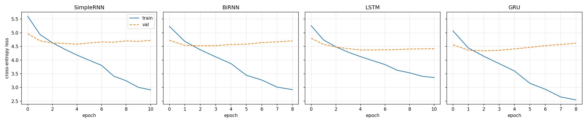
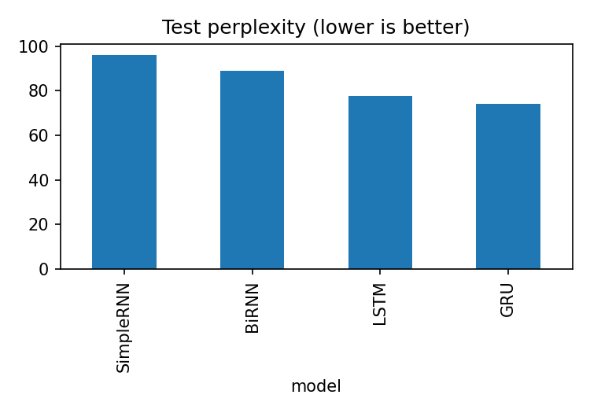

# Autoregressive Word-Level Text Generation on *Treasure Island*
### SimpleRNN vs Bidirectional RNN vs LSTM vs GRU

**Course:** Foundations of Generative AI (ICT4403), Assignment 2
**Author:** Sushant Shekhar Sinha (230953472)

---

## 1. Problem statement and objective

Build an autoregressive text-generation system that predicts the **next word** given a fixed-length context of previous words, and generates text one word at a time from a seed sequence. Four recurrent architectures are implemented and trained under **identical experimental conditions**:

1. Simple RNN
2. Bidirectional RNN
3. LSTM
4. GRU

The objectives are to:

- preprocess a text corpus and construct input-target sequences for next-word prediction;
- compare the models quantitatively (loss, perplexity, accuracy, training time) and qualitatively (coherence, diversity, contextual consistency, repetition);
- generate text from the **same seeds** at three or more sampling temperatures, analyse the effect of temperature, and justify which model is the most effective generator for this dataset.

## 2. Dataset

| Item | Detail |
|---|---|
| Title | *Treasure Island* |
| Author | Robert Louis Stevenson (published 1883) |
| Source | Project Gutenberg eBook #120 (public domain) |
| Book page | https://www.gutenberg.org/ebooks/120 |
| Plain-text file used | https://www.gutenberg.org/cache/epub/120/pg120.txt |
| Local copy | `data/treasure_island.txt` |

**Characteristics.** A first-person adventure novel narrated by Jim Hawkins, with recurring characters (Long John Silver, Dr. Livesey, Captain Smollett, Squire Trelawney), a strong nautical vocabulary (*hispaniola, coxswain, tiller, forecastle*) and a lot of dialogue. The text is about 82,000 tokens once punctuation is counted as tokens, which is small for neural language modelling. That makes it a good test of how much each architecture can learn from limited data, and it keeps training fast enough to run all four models on a free GPU.

**Preprocessing**

1. Remove the Project Gutenberg header and licence footer (text between the `*** START OF` and `*** END OF` markers is kept).
2. Lowercase, normalise curly apostrophes to `'`, collapse whitespace.
3. Tokenise with the regex `[a-z']+|[.,!?;:]`, so words and punctuation marks are separate tokens. Punctuation tokens make the generated text read far more naturally.
4. Split the token stream **by position** into contiguous blocks: 80% train / 10% validation / 10% test. A random split of overlapping windows would leak near-identical sequences between splits.
5. Build the vocabulary from the **training split only**. Words occurring fewer than 3 times are mapped to `<unk>`, and the special tokens `<pad>` and `<unk>` are added. **Final vocabulary size: 1,932.**
6. Create input-target pairs with a sliding window of **25 tokens** (stride 1): the input is tokens `t ... t+24` and the target is token `t+25`.

## 3. Models

All models share the same pipeline:

```
Embedding(vocab, 128) -> [recurrent layer] -> Dropout(0.2) -> Dense(vocab)   (softmax applied in the loss)
```

| Model | Recurrent layer | Parameters |
|---|---|---|
| SimpleRNN | `SimpleRNN(256)` | 842,380 |
| BiRNN | `Bidirectional(SimpleRNN(128))` (256 outputs after concatenation) | 809,612 |
| LSTM | `LSTM(256)` | 1,138,060 |
| GRU | `GRU(256)` | 1,040,268 |

Hidden-state width (256) is matched across models, with the BiRNN using 128 units per direction. The gated models have more parameters because LSTM and GRU contain 4 and 3 weight blocks per unit respectively (the parameter counts above are reported so this can be taken into account when comparing).

**Bidirectional RNN note:** the backward pass reads only the already-known 25-token context window, never future tokens, so the model is still a valid next-word predictor with no leakage.

**Training configuration (identical for all models)**

| Setting | Value |
|---|---|
| Loss | Sparse categorical cross-entropy (from logits) |
| Optimiser | Adam, learning rate 0.002, gradient clipping `clipnorm=1.0` |
| Batch size | 128 |
| Max epochs | 40 |
| Early stopping | monitor `val_loss`, patience 6, `min_delta=0.001`, restore best weights |
| LR schedule | `ReduceLROnPlateau` (factor 0.5, patience 2, min 1e-5) |
| Random seed | 42 (re-set before each model) |

## 4. Execution steps and dependencies

**Requirements:** Python 3.10+, TensorFlow 2.x (Keras), NumPy, pandas, matplotlib, requests. See `requirements.txt`.

```bash
git clone https://github.com/Sushant-py/treasure-island-rnn-text-generation.git
cd treasure-island-rnn-text-generation
pip install -r requirements.txt
jupyter notebook treasure_island_text_generation.ipynb
```

Or open the notebook in Google Colab and select **Runtime -> Change runtime type -> GPU**. Run all cells in order: setup, preprocessing, model definitions, training, loss curves, generation. The notebook downloads the book from Project Gutenberg if `treasure_island.txt` is not present. Total runtime is a few minutes on a GPU.

**Repository layout**

```
.
├── README.md
├── requirements.txt
├── treasure_island_text_generation.ipynb
├── data/
│   └── treasure_island.txt
└── outputs/
    ├── results_table.csv
    ├── loss_curves.png
    ├── test_perplexity.png
    ├── generated_samples.md
    └── generation_metrics.csv
```

## 5. Results

All numbers are from a single run (seed 42). **Perplexity = exp(test cross-entropy)**, measured on the held-out final 10% of the book, using the weights from the best validation epoch.

| Model | Epochs run | Best epoch | Train loss | Val loss | Test loss | **Test perplexity** | **Test accuracy** | Training time (s) | Sec / epoch | Parameters |
|---|---|---|---|---|---|---|---|---|---|---|
| SimpleRNN | 11 | 5 | 4.185 | 4.582 | 4.566 | 96.14 | 20.06% | 39.8 | 3.6 | 842,380 |
| BiRNN | 9 | 3 | 4.379 | 4.525 | 4.490 | 89.08 | 20.36% | 42.2 | 4.7 | 809,612 |
| LSTM | 11 | 5 | 4.129 | 4.372 | 4.351 | 77.56 | 21.30% | 53.2 | 4.8 | 1,138,060 |
| **GRU** | 9 | 3 | 4.141 | 4.339 | 4.304 | **74.02** | **21.40%** | **36.2** | 4.0 | 1,040,268 |

Train loss is reported at the best epoch and includes dropout, so it slightly overstates the true training error.




## 6. Model comparison and evaluation

- **Gated models win clearly.** GRU (74.0) and LSTM (77.6) reach much lower test perplexity than BiRNN (89.1) and SimpleRNN (96.1). GRU's perplexity is about 23% lower than SimpleRNN's. This gap is larger than the GRU-LSTM gap, so it is the most reliable finding. A plausible explanation is that the gating mechanisms let the network keep or discard information across the 25-token window, while a plain RNN's gradients shrink as they pass back through the sequence.
- **GRU is best overall.** It has the lowest loss and perplexity, the highest accuracy (21.4%), and the shortest total training time (36.2 s), with fewer parameters than LSTM. Its per-epoch cost (4.0 s) is between SimpleRNN (3.6 s) and LSTM (4.8 s).
- **GRU vs LSTM is close.** The 3.5-point perplexity difference is small, and with one seed it may be within run-to-run noise.
- **BiRNN beats SimpleRNN** (89.1 vs 96.1) with a similar parameter count. Reading the context window in both directions gives a richer summary of it, but it does not close the gap to the gated models.
- **Training time is not directly comparable.** Early stopping ended runs at different epochs (9 or 11), so seconds per epoch is the fairer cost measure.
- **Overfitting appears early.** The best validation epoch was only 3-5 for every model, because roughly 1M parameters quickly memorise about 65k training windows. Early stopping with best-weight restoration handled this. SimpleRNN shows the largest train/validation gap.
- **Perplexity scale.** Perplexity is measured over words and punctuation tokens with `<unk>` included, so it should not be compared with results from other corpora or tokenisers.
- **Accuracy.** All models are around 20-21% top-1 accuracy. That is reasonable for open-ended next-word prediction, where many continuations are plausible.

## 7. Sampling-temperature analysis

Text was generated for **50 words** from **three fixed seed sequences** (taken from the unseen test split) for every model at temperatures **0.5, 1.0 and 1.5**. `<pad>` and `<unk>` are blocked during sampling. The same random stream is used for each model, so differences come from the models, not from sampling luck. All generated samples are in `outputs/generated_samples.md`.

Example seeds:

> **Seed 1:** half way over, long john alone `<unk>` his shoulders and `<unk>` them wait till they were there. we pulled easily, by silver's
> **Seed 2:** indeed, it was soon plain to me that the lad was falling sick; `<unk>` by heat, `<unk>`, and the `<unk>` of

**Metrics (mean over the 3 seeds).** *Distinct-1* and *Distinct-2* are the fractions of unique words and unique word pairs (higher means more diverse). *Repeat-3* is the fraction of repeated word trigrams (higher means more looping).

| Temp | Model | Distinct-1 | Distinct-2 | Repeat-3 |
|---|---|---|---|---|
| 0.5 | SimpleRNN | 0.593 | 0.864 | 0.042 |
| 0.5 | BiRNN | 0.567 | 0.816 | 0.056 |
| 0.5 | LSTM | 0.613 | 0.898 | 0.007 |
| 0.5 | GRU | 0.627 | 0.884 | 0.035 |
| 1.0 | SimpleRNN | 0.753 | 0.986 | 0.000 |
| 1.0 | BiRNN | 0.780 | 0.993 | 0.000 |
| 1.0 | LSTM | 0.820 | 0.973 | 0.000 |
| 1.0 | GRU | 0.800 | 0.993 | 0.000 |
| 1.5 | SimpleRNN | 0.933 | 1.000 | 0.000 |
| 1.5 | BiRNN | 0.913 | 1.000 | 0.000 |
| 1.5 | LSTM | 0.940 | 1.000 | 0.000 |
| 1.5 | GRU | 0.933 | 1.000 | 0.000 |

**Temperature 0.5: coherent but repetitive.** The output is mostly grammatical and stays on the book's topics (*hispaniola, captain, mutineers, tiller, benbow*), but it falls back on high-frequency phrases such as "a good deal of" and "of the island", which appear in every model's output. Example (GRU): *"i was a good deal of the tiller and the next rays of the island. i was not a hundred yards for he had risen by the current, and the captain had risen and the worst of the island."* Word-level diversity is lowest here (Distinct-1 0.57-0.63), and repetition is highest, especially for BiRNN (Repeat-3 0.056). Sentences are locally fluent but do not follow a story.

**Temperature 1.0: more varied, with syntax starting to break.** Looping disappears (Repeat-3 is 0 for every model) and vocabulary diversity rises (Distinct-1 0.75-0.82), so rarer words and character names (*livesey, benbow, israel*) appear. Grammar degrades, for example GRU: *"desertion, mind the livesey, not give me rough your until that though mr than him."* Some local structure survives, but sentences rarely stay meaningful.

**Temperature 1.5: diverse but incoherent.** Nearly every word is unique (Distinct-1 0.91-0.94, Distinct-2 1.0), but the text is a string of unrelated words with no syntax, for example LSTM: *"report mine it i point and lose him back themselves grew i'd pew hailed, pain and under her breast in interest;"*. High temperature flattens the distribution so that rare words are sampled almost as often as likely ones.

**Summary.** Raising the temperature trades coherence for diversity. Low temperature gives the most readable text but repeats itself, and high temperature removes repetition but also meaning. For this dataset the best balance lies between 0.5 and 1.0. Differences between models at a given temperature are small compared with the differences between temperatures, and with 150 generated words per cell they should be read as indicative only.

## 8. Conclusion

**GRU is the best-performing model for this dataset.** It has the lowest test perplexity (74.0), the highest accuracy (21.4%) and the shortest total training time (36.2 s), with fewer parameters than the LSTM. Its generated text is among the most diverse at T = 0.5 (Distinct-1 0.627, the highest of the four) and at T = 1.0 it matches the best Distinct-2. LSTM is a close second. It has slightly lower repetition at T = 0.5 and slightly higher diversity at T = 1.0, but costs more per epoch and more parameters. The two plain RNN variants perform clearly worse, and SimpleRNN has the highest perplexity, the largest generalisation gap and the lowest accuracy. A temperature around 0.5 to 1.0 gives the best balance of coherence and diversity.

## 9. Limitations

- Results come from a single seed, and the GRU-LSTM difference is small enough to change with another seed.
- The gated models have more parameters than the plain RNNs, so part of their advantage may come from capacity.
- Qualitative judgements of coherence are based on reading a small number of samples, and diversity and repetition metrics are computed on only 3 x 50 generated words per setting.
- The dataset is small (about 82k tokens), so models overfit after a few epochs and none of them maintains a long-range storyline.
- Only plain temperature sampling is used. Top-k or nucleus sampling could improve readability at higher temperatures.

## 10. References

- Stevenson, R. L. (1883). *Treasure Island*. Project Gutenberg eBook #120. https://www.gutenberg.org/ebooks/120
- Hochreiter, S., and Schmidhuber, J. (1997). Long Short-Term Memory. *Neural Computation*, 9(8), 1735-1780.
- Cho, K., et al. (2014). Learning Phrase Representations using RNN Encoder-Decoder for Statistical Machine Translation. *EMNLP 2014*.
- Schuster, M., and Paliwal, K. K. (1997). Bidirectional Recurrent Neural Networks. *IEEE Transactions on Signal Processing*, 45(11), 2673-2681.
